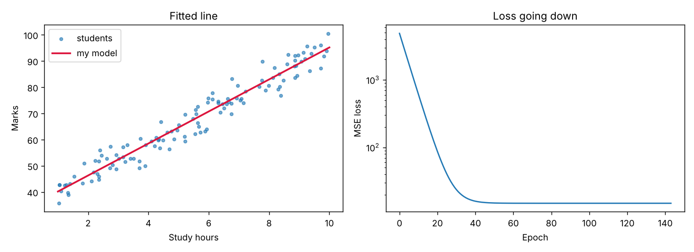

# 📈 Linear Regression from Scratch · Week 2 Project

Linear regression built with **only NumPy** (no scikit-learn), trained with **gradient descent**. Part of my [AI Engineering Log](../../README.md).



## 📊 Results

| Demo | Features | Test R² | Notes |
|---|:-:|:-:|---|
| Study hours → exam marks | 1 | **0.95** | Same line as NumPy's exact `np.polyfit` |
| House price | 3 (size, rooms, age) | **0.98** | Recovered the true weights closely |

```
Learned:  marks = 34.06 + 6.11 * hours   (true: 35 + 6 * hours)
np.polyfit check: marks = 34.06 + 6.11 * hours
```

## 🧠 How it works

1. **Predict:** `y_pred = X @ w + b`
2. **Measure:** MSE loss = `mean((y_pred - y) ** 2)`
3. **Gradients:** `dw = 2/n * X.T @ error`, `db = 2/n * sum(error)`
4. **Update:** `w -= lr * dw`, `b -= lr * db`, repeated until the loss stops improving

Features are **standardised** first (`(X - mean) / std`), so one learning rate works for every feature and training converges in about 150 epochs.

## 🧩 Week 2 concepts used

| Day | Concept | Where |
|:-:|---|---|
| 8–9 | NumPy arrays, vectorisation | Whole training loop, no Python loops over data |
| 11 | Matrix multiplication, transpose | `X @ w`, `X.T @ error` |
| 12 | Derivatives, gradients | `dw`, `db` |
| 13 | MSE loss, gradient descent | `fit()` |

## ▶️ Run it

```bash
pip install numpy matplotlib pytest
python linear_regression.py      # prints results, saves results.png
python -m pytest -v              # 7 tests
```

## 📁 Files

| File | What it is |
|---|---|
| `linear_regression.py` | `LinearRegressionGD` class, metrics (MSE, R²), train/test split, 2 demos |
| `test_linear_regression.py` | 7 tests, including a check against `np.polyfit` |
| `results.png` | Fitted line and loss curve |
