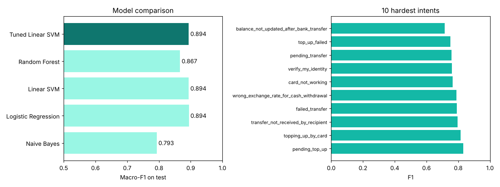

# 🏦 Banking Intent Classifier · Week 3 Project

Reads a customer's message and predicts which of **77 banking intents** it belongs to, using classic machine learning (TF-IDF + scikit-learn). Part of my [AI Engineering Log](../../README.md).



## 📊 Results (3,080 unseen test messages)

| Model | Accuracy | Macro-F1 | Train time |
|---|:-:|:-:|:-:|
| Naive Bayes | 0.799 | 0.793 | 3.0s |
| Random Forest | 0.867 | 0.867 | 28.5s |
| Logistic Regression | 0.894 | 0.894 | 14.4s |
| **Linear SVM** | **0.894** | **0.894** | **0.9s** |

Linear SVM ties for the best score and trains **16x faster** than logistic regression. GridSearchCV (5-fold, macro-F1) picked `C=3` with word 1–2 grams.

### Try it

```text
"my card still hasn't come in the post"              -> card_arrival
"someone stole my wallet with my debit card"         -> lost_or_stolen_card
"what rate do you use to convert dollars to euros?"  -> exchange_rate
"I was charged twice for the same coffee"            -> transaction_charged_twice
"how do I top up using apple pay"                    -> apple_pay_or_google_pay
```

### Where it struggles

The most confused intents have **very similar meanings**, e.g. `verify_my_identity` vs `why_verify_identity` vs `unable_to_verify_identity`, or `top_up_failed` vs `top_up_reverted`. Word counts can't tell them apart well; embeddings and transformers (Weeks 8+) should do better.

## 🧠 How it works

1. **TF-IDF** turns each message into numbers (word and word-pair importance)
2. **4 classifiers** compared on the same test set
3. **GridSearchCV** tunes the best one with 5-fold cross-validation on training data only
4. **Error analysis:** hardest intents, most confused pairs

## 🧩 Week 3 concepts used

| Day | Concept | Where |
|:-:|---|---|
| 16 | Train/test split, no leakage | Official split; tuning only on train |
| 17 | Logistic regression, TF-IDF | Text features + linear models |
| 18 | Random forest | One of the compared models |
| 19 | GridSearchCV, cross-validation | `tune_svm()` |
| 20 | Macro-F1, per-class F1, confusion | Fair scoring across 77 classes |

## ▶️ Run it

```bash
pip install scikit-learn matplotlib pytest
python banking_intents.py     # downloads the data on first run (~1 MB)
python -m pytest -v           # 4 tests
```

## 📁 Files

| File | What it is |
|---|---|
| `banking_intents.py` | Download, compare 4 models, tune, error analysis, plot |
| `test_banking_intents.py` | 4 fast offline tests |
| `results.png` | Model comparison + hardest intents |
| `data/` | Downloaded dataset (git-ignored) |

Dataset: [Banking77](https://github.com/PolyAI-LDN/task-specific-datasets) by PolyAI, CC-BY-4.0.
