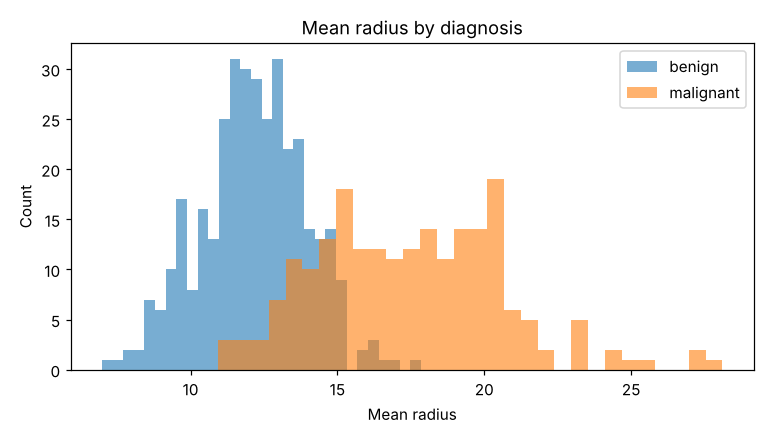
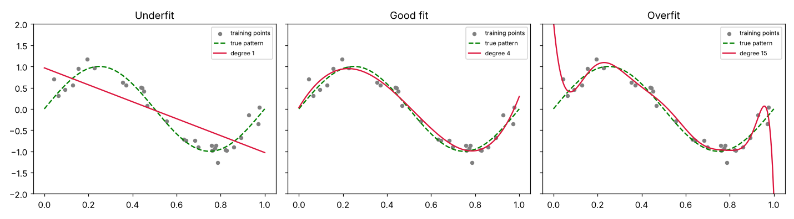
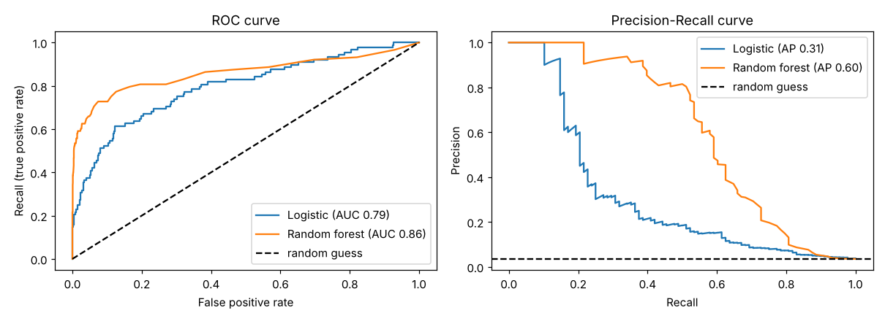

# 📝 Week 3 · Classic Machine Learning with scikit-learn

> My notes, in my own words. One section per day.

**Days this week:**
[Day 15](#-day-15--week-2-review--first-look-at-scikit-learn) ·
[Day 16](#-day-16--supervised-vs-unsupervised-splits--data-leakage) ·
[Day 17](#-day-17--logistic-regression--decision-trees) ·
[Day 18](#-day-18--random-forests--gradient-boosting) ·
[Day 19](#-day-19--overfitting-regularisation--cross-validation) ·
[Day 20](#-day-20--classification-metrics--class-imbalance) ·
[Day 21](#-day-21--%EF%B8%8F-week-3-project-banking-intent-classifier)

---

## 📅 Day 15 · Week 2 Review + First Look at scikit-learn

**Date:** Nov 15, 2026
**Code:** [`Day 15 - Week 2 Review and First Look at scikit-learn.py`](./Day%2015%20-%20Week%202%20Review%20and%20First%20Look%20at%20scikit-learn.py)

### 1. Week 2 Self-Check

I turned Week 2's main ideas into `assert` statements. If the file runs without an error, I still remember them.

| Idea | Check |
|---|---|
| Shapes & axis | `a.mean(axis=0)` gives one value per **column** |
| Broadcasting | A row vector is added to every row |
| A layer | `W @ x + b` |
| pandas | `groupby("city")["sales"].sum()` |
| Gradient descent | 100 steps on `(w - 3)²` lands on `w = 3` |

### 2. Exploring a Real Dataset (EDA)

**EDA (Exploratory Data Analysis)** = getting to know the data **before** building any model.

#### My EDA checklist

| Question | Code | Breast cancer answer |
|---|---|---|
| How big is it? | `df.shape` | 569 rows, 30 features |
| Anything missing? | `df.isna().sum()` | 0 missing |
| Are classes balanced? | `value_counts(normalize=True)` | 63% benign, 37% malignant |
| What do the numbers look like? | `df.describe()` | Very different scales (radius ~14, area ~650) |
| Which features matter? | `groupby` means, `.corr()` | `worst concave points` (0.79) |



> 💡 Different scales (radius vs area) are why **feature scaling** matters, just like in my Day 14 project.

### 3. The scikit-learn Pattern

Every model in scikit-learn works the same way:

```python
model = LinearRegression()      # 1. create
model.fit(X, y)                 # 2. learn
model.predict(X_new)            # 3. predict
model.score(X, y)               # 4. evaluate
```

| Term | Meaning |
|---|---|
| `X` | Features: a 2D table, one row per example |
| `y` | Target: the answer I want to predict |
| Estimator | Any model with `.fit()` |

> ✅ scikit-learn's `LinearRegression` gave **exactly the same weights** as solving it myself with NumPy (`np.linalg.lstsq`), so the Week 2 maths is what runs underneath.

---

## 📅 Day 16 · Supervised vs Unsupervised, Splits & Data Leakage

**Date:** Nov 16, 2026
**Code:** [`Day 16 - Supervised vs Unsupervised and Data Leakage.py`](./Day%2016%20-%20Supervised%20vs%20Unsupervised%20and%20Data%20Leakage.py)

### 1. Types of Machine Learning

| Type | Has the answers? | Goal | Example today | Result |
|---|:-:|---|---|---|
| **Supervised: classification** | ✅ | Predict a **category** | Benign or malignant | 98.2% accuracy |
| **Supervised: regression** | ✅ | Predict a **number** | Diabetes progression | MAE 42.8 points |
| **Unsupervised: clustering** | ❌ | Find groups by itself | Iris flowers | Matched species 0.73 (ARI) |

> 💡 KMeans never saw the species labels, yet its 3 groups matched the real species quite well.

### 2. Train / Validation / Test

| Set | Share | Used for |
|---|:-:|---|
| **Train** | 60% | The model learns from it |
| **Validation** | 20% | I compare settings and choose the best |
| **Test** | 20% | Final score, looked at **only once** |

```python
# 1. Cut off the test set first
X_temp, X_test, y_temp, y_test = train_test_split(X, y, test_size=0.2, stratify=y)
# 2. Split the rest into train and validation (0.25 of 80% = 20%)
X_train, X_val, y_train, y_val = train_test_split(X_temp, y_temp, test_size=0.25, stratify=y_temp)
```

- **`stratify=y`** keeps the same benign/malignant share in every set (0.63 / 0.62 / 0.63).
- **`random_state`** makes the split the same every run.

#### Choosing a setting with validation

| C | Validation accuracy |
|:-:|:-:|
| 0.001 | 0.851 |
| 0.01 | 0.939 |
| 0.1 | 0.974 |
| **1** | **0.991** ✅ |
| 10 | 0.965 |

Picked `C=1`, retrained on train + validation, then tested once: **0.982**.

> ⚠️ If I choose settings by looking at the **test** score, the test set stops being a fair final exam.

### 3. Data Leakage

**Leakage** = information from outside the training data sneaks into training, so the score looks better than the model really is.

#### Example 1: preparing data before splitting

On **pure random noise** (the honest answer is a coin flip, about 50%):

| Method | Accuracy |
|---|:-:|
| ❌ Pick best features using **all** data, then cross-validate | **0.87** (a lie) |
| ✅ Feature selection **inside a Pipeline** | **0.48** (the truth) |

```python
model = make_pipeline(SelectKBest(f_classif, k=20), LogisticRegression())
cross_val_score(model, X, y, cv=5)    # each step only sees the training folds
```

#### Example 2: a feature that contains the answer

I added a fake "second opinion result" column, which is only known **after** the diagnosis:

| Features | Accuracy |
|---|:-:|
| With the leaky column | 1.000 |
| Without it | 0.982 |

#### How to avoid leakage

- Split **first**, then scale, select features or fill missing values.
- Put every preprocessing step in a **`Pipeline`**.
- Ask for every feature: *"Would I know this at prediction time?"*
- Treat a near-perfect score as a **warning sign**, not a win.

---

## 📅 Day 17 · Logistic Regression & Decision Trees

**Date:** Nov 17, 2026
**Code:** [`Day 17 - Logistic Regression and Decision Trees.py`](./Day%2017%20-%20Logistic%20Regression%20and%20Decision%20Trees.py)

### 1. Logistic Regression

Despite the name, it's a **classification** model. It works like linear regression, then squeezes the result into a probability with the **sigmoid**:

```text
probability = sigmoid(w · x + b)        sigmoid(z) = 1 / (1 + e^-z)
```

| z | sigmoid(z) |
|:-:|:-:|
| -5 | 0.007 |
| 0 | 0.500 |
| 5 | 0.993 |

- `predict_proba()` gives the probability; `predict()` uses a 0.5 cut-off.
- **Coefficients** show which features push towards each class (after scaling).
- Result: **98.2%** test accuracy on breast cancer data.

### 2. Decision Trees

A flowchart of yes/no questions the model learns from the data:

```text
worst radius <= 16.8?
├── yes → worst concave points <= 0.14? → benign / malignant
└── no  → texture error <= 0.47?        → benign / malignant
```

#### Depth controls overfitting

| max_depth | Train | Test |
|:-:|:-:|:-:|
| 1 | 0.923 | 0.921 |
| **3** | 0.976 | **0.939** |
| 5 | 0.993 | 0.921 |
| None | **1.000** | 0.912 |

> ⚠️ 100% on train but worse on test = **overfitting**: the tree memorised the training data.

### 3. Logistic Regression vs Decision Tree

| | Logistic regression | Decision tree |
|---|---|---|
| Shape of the boundary | Straight line / plane | Boxes (step-like) |
| Needs scaling | ✅ Yes | ❌ No |
| Easy to explain | Coefficients | Readable yes/no rules |
| Risk | Underfits curved patterns | Overfits when deep |

### 4. Classification Report

| Metric | Question it answers |
|---|---|
| **Precision** | Of the ones I said were malignant, how many really were? |
| **Recall** | Of all the real malignant ones, how many did I catch? |
| **F1** | One number balancing precision and recall |
| **Support** | How many real examples of that class |

### 5. Text with TF-IDF

**TF-IDF** turns text into numbers: a word scores high if it's common in **this** message but rare across **all** messages.

```python
spam_model = make_pipeline(TfidfVectorizer(), LogisticRegression())
```

My mini spam detector learned that **free, now, won, selected** point to spam.

### 🛠️ What I Built

| Part | What it does |
|---|---|
| Sigmoid demo | Shows how scores become probabilities |
| Cancer classifier | Logistic regression with probabilities and feature importance |
| Tree depth experiment | Shows overfitting as depth grows |
| Spam detector | TF-IDF + logistic regression on 12 messages |

---

## 📅 Day 18 · Random Forests & Gradient Boosting

**Date:** Nov 18, 2026
**Code:** [`Day 18 - Random Forests and Gradient Boosting.py`](./Day%2018%20-%20Random%20Forests%20and%20Gradient%20Boosting.py)

### 1. Why One Tree Isn't Enough

Training trees on slightly different samples of the same data gave different first questions and different scores (0.912 to 0.930). A single tree is **unstable** (high variance).

### 2. Ensembles: Many Models Together

| | **Bagging** (Random Forest) | **Boosting** (Gradient Boosting) |
|---|---|---|
| How trees are built | **In parallel**, independently | **One after another** |
| Each tree learns from | A random sample of rows (bootstrap) + random features | The **mistakes** of the trees before it |
| Final answer | Majority vote | Sum of all trees' small corrections |
| Mainly fixes | Variance (overfitting) | Bias (underfitting) |
| Famous versions | `RandomForestClassifier` | `GradientBoosting`, **XGBoost**, LightGBM |

#### Bagging by hand

| | Accuracy |
|---|:-:|
| Average single tree | 0.908 |
| 25 trees voting | **0.939** |

### 3. Model Comparison (5-fold cross-validation)

| Model | Mean accuracy | Std |
|---|:-:|:-:|
| Decision tree | 0.917 | 0.024 |
| Random forest | 0.958 | 0.024 |
| Gradient boosting | 0.963 | 0.021 |
| **Hist gradient boosting** | **0.965** | **0.018** |

> 💡 **Cross-validation** trains and tests 5 times on different splits, so the score doesn't depend on one lucky split.

### 4. Random Forest Details

- **More trees** = more stable (results settled around 50 trees).
- **Out-of-bag (OOB) score:** each tree skips about a third of the rows, which works as free validation. OOB = **0.960**.
- **Feature importance:** `worst perimeter`, `worst area`, `worst concave points` mattered most.

### 5. Gradient Boosting: Learning Rate

| learning_rate | After 10 trees | After 100 trees |
|:-:|:-:|:-:|
| 0.01 | 0.632 | 0.921 |
| 0.1 | 0.930 | 0.956 |
| 1.0 | 0.947 | 0.956 |

Small learning rate = slow but careful (needs more trees). Too big = can overshoot and overfit.

### 6. Multi-class: Wine (3 classes)

| Model | Accuracy |
|---|:-:|
| Decision tree | 0.865 |
| **Random forest** | **0.967** |
| Hist gradient boosting | 0.955 |

### 🛠️ What I Built

| Part | What it shows |
|---|---|
| Unstable trees | Same data, different trees |
| Bagging by hand | 25 trees voting beat one tree |
| Model comparison | Ensembles beat a single tree in cross-validation |
| Learning-rate experiment | How boosting improves tree by tree |

---

## 📅 Day 19 · Overfitting, Regularisation & Cross-Validation

**Date:** Nov 19, 2026
**Code:** [`Day 19 - Overfitting Regularization and Cross-Validation.py`](./Day%2019%20-%20Overfitting%20Regularization%20and%20Cross-Validation.py)

### 1. Bias vs Variance



| Polynomial degree | Train MSE | New-data MSE | Problem |
|:-:|:-:|:-:|---|
| 1 | 0.187 | 0.233 | **Underfit**: too simple (high bias) |
| **4** | 0.025 | **0.045** | ✅ Just right |
| 15 | **0.015** | 0.154 | **Overfit**: memorised the noise (high variance) |

> 💡 The overfit model has the **best training score** and a bad score on new data. Always judge a model on data it hasn't seen.

| | High bias (underfit) | High variance (overfit) |
|---|---|---|
| Train score | Bad | Very good |
| Test score | Bad | Bad |
| Fixes | More features, more complex model | More data, simpler model, **regularisation** |

### 2. Regularisation: L1 & L2

Regularisation adds a **penalty for large weights**, which keeps the model simpler.

| | **Ridge (L2)** | **Lasso (L1)** |
|---|---|---|
| Penalty | Sum of **squared** weights | Sum of **absolute** weights |
| Effect | Shrinks all weights a little | Can push weights to **exactly 0** |
| Use it for | Many useful, related features | Automatic **feature selection** |
| Strength | `alpha`: bigger = simpler model | `alpha`: bigger = more zeros |

- Lasso `alpha=1` dropped one feature and kept the other 9.
- With 220 polynomial features, plain linear regression **broke** (R² **-13.69**) while Ridge stayed sensible (R² **0.42**).

> ⚠️ Scale features before Ridge/Lasso; otherwise the penalty treats features unfairly.

### 3. Cross-Validation

One split depends on luck: the same tree scored anywhere from **0.904 to 0.939** with different seeds.

**K-fold cross-validation** splits the data into K parts, trains K times, and each part is the test set once:

```text
5-fold CV: [0.939 0.912 0.912 0.947 0.956] -> mean 0.933 ± 0.018
```

The mean is a fairer score, and the ± shows how stable the model is.

### 4. Hyperparameter Tuning

| | **GridSearchCV** | **RandomizedSearchCV** |
|---|---|---|
| Tries | **Every** combination | A **random sample** of combinations |
| Good for | Small grids | Big search spaces |
| Today | 18 combinations → best `max_depth=4`, test **0.939** | 10 tries → best `C=0.121`, test **0.974** |

```python
grid = GridSearchCV(model, param_grid={"max_depth": [2, 3, 4, 5]}, cv=5)
grid.fit(X_train, y_train)
grid.best_params_, grid.best_score_
```

> 💡 Inside a Pipeline, parameter names use the step name: `logisticregression__C`.

### 🛠️ What I Built

| Part | What it shows |
|---|---|
| Polynomial fits (degree 1, 4, 15) | Underfit vs good fit vs overfit, with a plot |
| Ridge vs Lasso comparison | How regularisation shrinks or removes weights |
| Single split vs 5-fold CV | Why one split isn't reliable |
| GridSearch + RandomizedSearch | Automatic hyperparameter tuning |

---

## 📅 Day 20 · Classification Metrics & Class Imbalance

**Date:** Nov 20, 2026
**Code:** [`Day 20 - Classification Metrics and Class Imbalance.py`](./Day%2020%20-%20Classification%20Metrics%20and%20Class%20Imbalance.py)

The problem: a **fraud detector** where only **3.5%** of transactions are fraud.

### 1. The Accuracy Trap

A "model" that **always says not fraud** gets **96.5% accuracy** and catches **zero** fraud. On imbalanced data, accuracy alone is useless.

### 2. Confusion Matrix

| | Predicted OK | Predicted FRAUD |
|---|:-:|:-:|
| **Actually OK** | TN = 2412 | FP = 0 |
| **Actually FRAUD** | FN = 79 | TP = 9 |

| Metric | Formula | Plain question | Here |
|---|---|---|:-:|
| **Precision** | TP / (TP + FP) | Of my fraud alerts, how many were real? | 1.000 |
| **Recall** | TP / (TP + FN) | Of all real fraud, how much did I catch? | 0.102 |
| **F1** | 2·P·R / (P + R) | Balance of the two | 0.186 |
| **ROC-AUC** | Area under ROC curve | How well scores rank fraud above normal | 0.794 |
| **PR-AUC** | Area under precision-recall curve | Ranking quality when positives are rare | 0.307 |

### 3. The Threshold

The model gives a probability; the **threshold** decides when to call it fraud.

| Threshold | Fraud caught (recall) | Alerts that were real (precision) | Alerts |
|:-:|:-:|:-:|:-:|
| 0.5 | 10% | 100% | 9 |
| 0.3 | 20% | 60% | 30 |
| 0.15 | 31% | 32% | 85 |
| 0.05 | 62% | 12% | 448 |

> 💡 Lower threshold = catch more, but more false alarms. Choose the threshold on **training/validation** data, never on test.

### 4. Handling Imbalance

| Method | Recall | Precision | F1 | PR-AUC |
|---|:-:|:-:|:-:|:-:|
| Logistic regression | 0.102 | 1.000 | 0.186 | 0.307 |
| Logistic, `class_weight="balanced"` | **0.716** | 0.092 | 0.162 | 0.228 |
| Logistic, oversampled fraud rows | 0.705 | 0.091 | 0.161 | 0.223 |
| Random forest, balanced | 0.114 | 1.000 | 0.204 | **0.600** |
| **Random forest, threshold 0.3** | 0.295 | 0.929 | **0.448** | **0.600** |

- **`class_weight="balanced"`** makes mistakes on the rare class cost more.
- **Oversampling** copies rare rows in the **training** set only (SMOTE creates new synthetic ones).
- **Changing the threshold** is often the simplest, strongest fix.

### 5. ROC & Precision-Recall Curves



### 6. Which Metric When?

| Situation | Watch |
|---|---|
| Missing a positive is costly (fraud, cancer) | **Recall** |
| False alarms are costly (spam filter, blocking a card) | **Precision** |
| Rare positive class | **PR-AUC**, **F1** (not accuracy) |
| Balanced classes, equal costs | Accuracy is fine |

### 🛠️ What I Built

| Part | What it shows |
|---|---|
| Dummy model | 96.5% accuracy with zero fraud caught |
| Confusion matrix by hand | Where precision and recall come from |
| Threshold experiment | The precision-recall trade-off |
| Imbalance fixes | Class weights, oversampling, thresholds compared |
| ROC + PR curves | Random forest ranks fraud much better (PR-AUC 0.60 vs 0.31) |

---

## 📅 Day 21 · 🛠️ Week 3 Project: Banking Intent Classifier

**Date:** Nov 21, 2026
**Code:** [`Day 21 - Banking Intent Classifier Project/`](./Day%2021%20-%20Banking%20Intent%20Classifier%20Project/)

### What I Built

A classifier that reads a bank customer's message and predicts which of **77 intents** it is (card arrival, stolen card, exchange rate, top-up failed ...), trained on the public **Banking77** dataset (10,003 train / 3,080 test messages).


### Results

| Model | Accuracy | Macro-F1 | Train time |
|---|:-:|:-:|:-:|
| Naive Bayes | 0.799 | 0.793 | 3.0s |
| Random Forest | 0.867 | 0.867 | 28.5s |
| Logistic Regression | 0.894 | 0.894 | 14.4s |
| **Linear SVM** | **0.894** | **0.894** | **0.9s** |

> 💡 Linear models work very well on TF-IDF text features: lots of features, mostly zeros, and classes that can be separated by straight lines.

### Why macro-F1?

With 77 classes, **macro-F1** gives every intent the same weight, so the model can't look good by only getting the common intents right.

### Error Analysis

| Hardest intents | F1 |
|---|:-:|
| balance_not_updated_after_bank_transfer | 0.71 |
| top_up_failed | 0.75 |
| pending_transfer | 0.76 |

The most confused pairs mean almost the same thing: `verify_my_identity` vs `why_verify_identity`, `top_up_failed` vs `top_up_reverted`. Word counts can't capture meaning; **embeddings** (Week 8) should help.

### Tests (4 passed ✅)

All models fit and predict · obvious intents are learned · TF-IDF keeps word pairs · the confusion helper ignores correct answers.

---

# ✅ Week 3 complete
