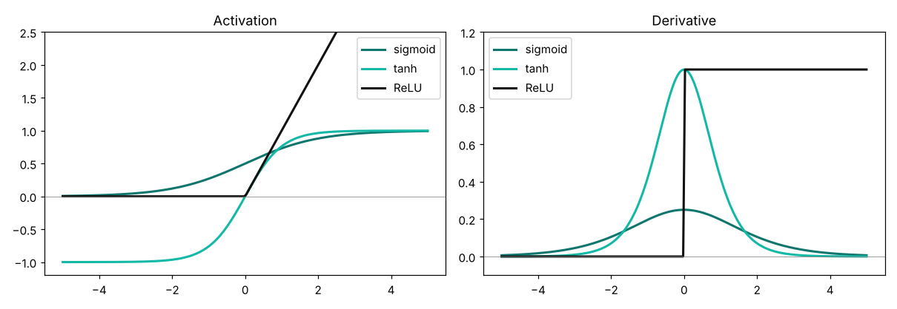
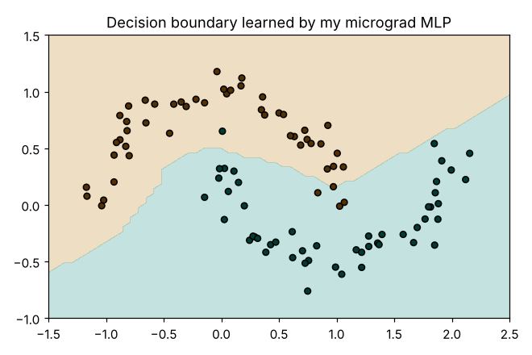

# 📝 Week 4 · Neural Networks & PyTorch Basics

> My notes, in my own words. One section per day.

**Days this week:**
[Day 22](#-day-22--week-3-review--micrograd-part-1) ·
[Day 23](#-day-23--perceptron-neurons--activations) ·
[Day 24](#-day-24--backpropagation--my-own-micrograd) ·
Day 25 · Day 26 · Day 27 · Day 28

---

## 📅 Day 22 · Week 3 Review + Micrograd Part 1

**Date:** Nov 22, 2026
**Code:** [`Day 22 - Week 3 Review and Micrograd Part 1.py`](./Day%2022%20-%20Week%203%20Review%20and%20Micrograd%20Part%201.py)

### 1. Week 3 Self-Check

`stratify` keeps class shares equal · a `Pipeline` prevents leakage in cross-validation · precision, recall and F1 computed by hand match scikit-learn exactly. ✅

### 2. What a Derivative Really Is

**How much the output moves when I nudge the input a tiny bit.**

```python
slope ≈ (f(x + h) - f(x)) / h
```

For `f(x) = 3x² - 4x + 5` at `x = 3`, the slope gets closer to the exact answer **14** as `h` gets smaller.

With several inputs, nudge **one** and keep the others fixed. For `d = a*b + c`:

| Derivative | Value | Why |
|---|:-:|---|
| ∂d/∂a | b = -3 | `a` is multiplied by `b` |
| ∂d/∂b | a = 2 | `b` is multiplied by `a` |
| ∂d/∂c | 1 | `c` is just added |

### 3. The Computation Graph

A `Value` object stores its number **and** remembers which values and which operation made it. That turns a formula into a graph:

```text
L = -8 (made by *)
├── f = -2
└── d = 4 (made by +)
    ├── e = -6 (made by *)
    │   ├── a = 2
    │   └── b = -3
    └── c = 10
```

### 4. Backpropagation by Hand

Start at the output (`dL/dL = 1`) and walk **backwards** with the **chain rule**:

| Rule | Meaning |
|---|---|
| `+` node | Passes the gradient through **unchanged** to both inputs |
| `*` node | Each input gets the gradient × **the other input's value** |
| Chain rule | `dL/da = dL/de × de/da` |

| | a | b | c | f |
|---|:-:|:-:|:-:|:-:|
| Gradient by hand | 6 | -4 | -2 | 4 |
| Numerical check | 6 | -4 | -2 | 4 ✅ |

> 💡 A gradient tells me which direction to move each input to change the output. Training = moving the weights **against** the gradient of the loss.

---

## 📅 Day 23 · Perceptron, Neurons & Activations

**Date:** Nov 23, 2026
**Code:** [`Day 23 - Perceptron Neurons and Activations.py`](./Day%2023%20-%20Perceptron%20Neurons%20and%20Activations.py)

### 1. The Perceptron

`output = step(w · x + b)`, learned with `w += lr × (target − prediction) × x`.

| Gate | Learned? |
|---|:-:|
| AND | ✅ |
| OR | ✅ |
| XOR | ❌ |

> ⚠️ XOR can't be split with **one straight line**, so a single neuron can never learn it. This is why we need **layers**.

### 2. Activation Functions



| Function | Formula | Output range | Gradient at z = 5 | Used for |
|---|---|:-:|:-:|---|
| **Sigmoid** | 1 / (1 + e⁻ᶻ) | (0, 1) | 0.0066 | Probability for yes/no outputs |
| **tanh** | (eᶻ − e⁻ᶻ)/(eᶻ + e⁻ᶻ) | (−1, 1) | 0.0002 | Hidden layers in small nets |
| **ReLU** | max(0, z) | [0, ∞) | 1 | Hidden layers in modern nets |
| **Softmax** | eᶻⁱ / Σ eᶻ | (0, 1), sums to 1 | | Multi-class output |

> 💡 **Vanishing gradients:** sigmoid and tanh almost stop learning for big inputs (gradient ≈ 0). ReLU keeps a gradient of 1, which is a big reason deep nets use it.

### 3. Neuron → Layer → Network

| Piece | In NumPy |
|---|---|
| Neuron | `tanh(w @ x + b)` |
| Layer of 4 neurons | `tanh(W @ x + b)` with `W` shape (4, 3), one **row per neuron** |
| A batch of 5 examples | `tanh(X @ W.T + b)` → shape (5, 4) |

### 4. Two Layers Solve XOR

| Input | Hidden (OR, AND) | Output |
|:-:|:-:|:-:|
| 0 0 | 0, 0 | 0 |
| 0 1 | 1, 0 | 1 |
| 1 0 | 1, 0 | 1 |
| 1 1 | 1, 1 | 0 |

XOR = **OR and not AND**. Stacking layers with a non-linear activation lets a network draw **curved** boundaries.

---

## 📅 Day 24 · Backpropagation & My Own Micrograd

**Date:** Nov 24, 2026
**Code:** [`Day 24 - Backpropagation and Micrograd.py`](./Day%2024%20-%20Backpropagation%20and%20Micrograd.py)

### 1. The Autograd Engine

Every operation (`+`, `*`, `**`, `tanh`, `relu`, `exp`) creates a new `Value` **and** a small `_backward()` function that knows how to push the gradient to its inputs.

```python
def backward(self):
    # 1. topological sort: every node after the nodes it depends on
    # 2. set self.grad = 1
    # 3. call _backward() on every node, from the output back to the inputs
```

| Operation | Local derivative used in `_backward` |
|---|---|
| `a + b` | 1 for both |
| `a * b` | the other value |
| `a ** k` | k · aᵏ⁻¹ |
| `tanh(a)` | 1 − tanh²(a) |
| `relu(a)` | 1 if a > 0 else 0 |
| `exp(a)` | exp(a) |

> ⚠️ Gradients must be **added** (`+=`), not set (`=`). In `y = x + x`, `x` is used twice and its gradient must be **2**, not 1.

### 2. Gradient Check

On a messy expression with `tanh`, `exp`, division and `relu`, my backprop matched the numerical derivatives to 6 decimal places ✅.

### 3. Neuron, Layer, MLP on Top of the Engine

```python
net = MLP(3, [4, 4, 1])          # 41 parameters
for step in range(60):
    preds = [net(x) for x in xs]                         # 1. forward
    loss = sum((p - y) ** 2 for p, y in zip(preds, ys))  # 2. loss
    for p in net.parameters(): p.grad = 0.0              # 3. zero the gradients
    loss.backward()                                      # 4. backward
    for p in net.parameters(): p.data -= 0.05 * p.grad   # 5. update
```

Loss went from **5.28 to 0.02**; predictions `[0.95, -0.91, -0.94, 0.91]` vs targets `[1, -1, -1, 1]`.

> 💡 These 5 steps are **exactly** the PyTorch training loop I'll write tomorrow, just with tensors instead of my `Value` class.

### 4. Two Moons

A 2-16-16-1 ReLU network (337 parameters) with hinge loss, L2 regularisation and learning-rate decay reached **95% accuracy**:



### 🛠️ What I Built This Week So Far

| Day | Built |
|---|---|
| 22 | Computation graph + manual backprop, checked numerically |
| 23 | Perceptron (AND/OR yes, XOR no) + a hand-made 2-layer XOR network |
| 24 | My own autograd engine and an MLP that learns two moons |

---
