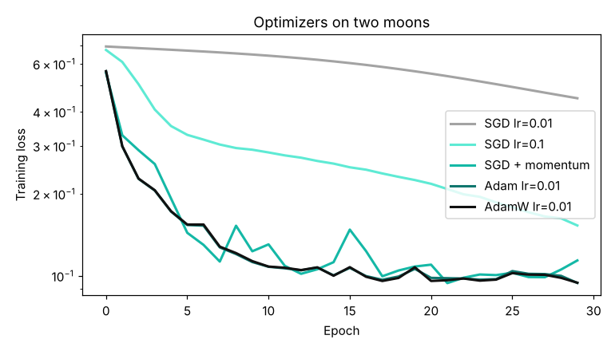
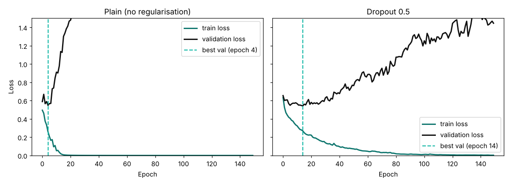

# 📝 Week 4 · Neural Networks & PyTorch Basics

> My notes, in my own words. One section per day.

**Days this week:**
[Day 22](#-day-22--week-3-review--micrograd-part-1) ·
[Day 23](#-day-23--perceptron-neurons--activations) ·
[Day 24](#-day-24--backpropagation--my-own-micrograd) ·
[Day 25](#-day-25--pytorch-tensors-autograd--dataloader) ·
[Day 26](#-day-26--the-training-loop--optimizers) ·
[Day 27](#-day-27--batch-size-regularisation--saving-models) · Day 28

---

## 📅 Day 22 · Week 3 Review + Micrograd Part 1

**Date:** Nov 22, 2026
**Code:** [`Day 22 - Week 3 Review and Micrograd Part 1.py`](./Day%2022%20-%20Week%203%20Review%20and%20Micrograd%20Part%201.py)

### 1. Week 3 Self-Check

`stratify` keeps class shares equal · a `Pipeline` prevents leakage in cross-validation · precision, recall and F1 computed by hand match scikit-learn exactly. ✅

### 2. What a Derivative Really Is

**How much the output moves when I nudge the input a tiny bit.**

```python
slope ≈ (f(x + h) - f(x)) / h
```

For `f(x) = 3x² - 4x + 5` at `x = 3`, the slope gets closer to the exact answer **14** as `h` gets smaller.

With several inputs, nudge **one** and keep the others fixed. For `d = a*b + c`:

| Derivative | Value | Why |
|---|:-:|---|
| ∂d/∂a | b = -3 | `a` is multiplied by `b` |
| ∂d/∂b | a = 2 | `b` is multiplied by `a` |
| ∂d/∂c | 1 | `c` is just added |

### 3. The Computation Graph

A `Value` object stores its number **and** remembers which values and which operation made it. That turns a formula into a graph:

```text
L = -8 (made by *)
├── f = -2
└── d = 4 (made by +)
    ├── e = -6 (made by *)
    │   ├── a = 2
    │   └── b = -3
    └── c = 10
```

### 4. Backpropagation by Hand

Start at the output (`dL/dL = 1`) and walk **backwards** with the **chain rule**:

| Rule | Meaning |
|---|---|
| `+` node | Passes the gradient through **unchanged** to both inputs |
| `*` node | Each input gets the gradient × **the other input's value** |
| Chain rule | `dL/da = dL/de × de/da` |

| | a | b | c | f |
|---|:-:|:-:|:-:|:-:|
| Gradient by hand | 6 | -4 | -2 | 4 |
| Numerical check | 6 | -4 | -2 | 4 ✅ |

> 💡 A gradient tells me which direction to move each input to change the output. Training = moving the weights **against** the gradient of the loss.

---

## 📅 Day 23 · Perceptron, Neurons & Activations

**Date:** Nov 23, 2026
**Code:** [`Day 23 - Perceptron Neurons and Activations.py`](./Day%2023%20-%20Perceptron%20Neurons%20and%20Activations.py)

### 1. The Perceptron

`output = step(w · x + b)`, learned with `w += lr × (target − prediction) × x`.

| Gate | Learned? |
|---|:-:|
| AND | ✅ |
| OR | ✅ |
| XOR | ❌ |

> ⚠️ XOR can't be split with **one straight line**, so a single neuron can never learn it. This is why we need **layers**.

### 2. Activation Functions


| Function | Formula | Output range | Gradient at z = 5 | Used for |
|---|---|:-:|:-:|---|
| **Sigmoid** | 1 / (1 + e⁻ᶻ) | (0, 1) | 0.0066 | Probability for yes/no outputs |
| **tanh** | (eᶻ − e⁻ᶻ)/(eᶻ + e⁻ᶻ) | (−1, 1) | 0.0002 | Hidden layers in small nets |
| **ReLU** | max(0, z) | [0, ∞) | 1 | Hidden layers in modern nets |
| **Softmax** | eᶻⁱ / Σ eᶻ | (0, 1), sums to 1 | | Multi-class output |

> 💡 **Vanishing gradients:** sigmoid and tanh almost stop learning for big inputs (gradient ≈ 0). ReLU keeps a gradient of 1, which is a big reason deep nets use it.

### 3. Neuron → Layer → Network

| Piece | In NumPy |
|---|---|
| Neuron | `tanh(w @ x + b)` |
| Layer of 4 neurons | `tanh(W @ x + b)` with `W` shape (4, 3), one **row per neuron** |
| A batch of 5 examples | `tanh(X @ W.T + b)` → shape (5, 4) |

### 4. Two Layers Solve XOR

| Input | Hidden (OR, AND) | Output |
|:-:|:-:|:-:|
| 0 0 | 0, 0 | 0 |
| 0 1 | 1, 0 | 1 |
| 1 0 | 1, 0 | 1 |
| 1 1 | 1, 1 | 0 |

XOR = **OR and not AND**. Stacking layers with a non-linear activation lets a network draw **curved** boundaries.

---

## 📅 Day 24 · Backpropagation & My Own Micrograd

**Date:** Nov 24, 2026
**Code:** [`Day 24 - Backpropagation and Micrograd.py`](./Day%2024%20-%20Backpropagation%20and%20Micrograd.py)

### 1. The Autograd Engine

Every operation (`+`, `*`, `**`, `tanh`, `relu`, `exp`) creates a new `Value` **and** a small `_backward()` function that knows how to push the gradient to its inputs.

```python
def backward(self):
    # 1. topological sort: every node after the nodes it depends on
    # 2. set self.grad = 1
    # 3. call _backward() on every node, from the output back to the inputs
```

| Operation | Local derivative used in `_backward` |
|---|---|
| `a + b` | 1 for both |
| `a * b` | the other value |
| `a ** k` | k · aᵏ⁻¹ |
| `tanh(a)` | 1 − tanh²(a) |
| `relu(a)` | 1 if a > 0 else 0 |
| `exp(a)` | exp(a) |

> ⚠️ Gradients must be **added** (`+=`), not set (`=`). In `y = x + x`, `x` is used twice and its gradient must be **2**, not 1.

### 2. Gradient Check

On a messy expression with `tanh`, `exp`, division and `relu`, my backprop matched the numerical derivatives to 6 decimal places ✅.

### 3. Neuron, Layer, MLP on Top of the Engine

```python
net = MLP(3, [4, 4, 1])          # 41 parameters
for step in range(60):
    preds = [net(x) for x in xs]                         # 1. forward
    loss = sum((p - y) ** 2 for p, y in zip(preds, ys))  # 2. loss
    for p in net.parameters(): p.grad = 0.0              # 3. zero the gradients
    loss.backward()                                      # 4. backward
    for p in net.parameters(): p.data -= 0.05 * p.grad   # 5. update
```

Loss went from **5.28 to 0.02**; predictions `[0.95, -0.91, -0.94, 0.91]` vs targets `[1, -1, -1, 1]`.

> 💡 These 5 steps are **exactly** the PyTorch training loop I'll write tomorrow, just with tensors instead of my `Value` class.

### 4. Two Moons

A 2-16-16-1 ReLU network (337 parameters) with hinge loss, L2 regularisation and learning-rate decay reached **95% accuracy**:


### 🛠️ What I Built (Days 22–24)

| Day | Built |
|---|---|
| 22 | Computation graph + manual backprop, checked numerically |
| 23 | Perceptron (AND/OR yes, XOR no) + a hand-made 2-layer XOR network |
| 24 | My own autograd engine and an MLP that learns two moons |

---

## 📅 Day 25 · PyTorch Tensors, Autograd & DataLoader

**Date:** Nov 25, 2026
**Code:** [`Day 25 - PyTorch Tensors Autograd and DataLoader.py`](./Day%2025%20-%20PyTorch%20Tensors%20Autograd%20and%20DataLoader.py)

### 1. Tensors

A tensor is a **NumPy array that can run on a GPU and track gradients**.

| Task | Code |
|---|---|
| Create | `torch.tensor([[1., 2.], [3., 4.]])`, `torch.zeros(3)`, `torch.rand(2, 2)` |
| Info | `.shape`, `.dtype`, `.device` |
| Element-wise vs matrix | `a * b` vs `a @ b` |
| Along an axis | `a.mean(dim=0)` (like NumPy's `axis`) |
| Reshape | `.reshape(3, 4)`, `.view(2, -1)`, `.unsqueeze(0)` (adds a batch dimension) |
| NumPy ↔ PyTorch | `torch.from_numpy(arr)`, `t.numpy()` |
| Python number | `t.item()` |

### 2. Devices

```python
device = "cuda" if torch.cuda.is_available() else "cpu"
x = x.to(device)
```

> ⚠️ The model and its data must be on the **same** device.

### 3. Autograd = PyTorch's Micrograd

```python
a = torch.tensor(2.0, requires_grad=True)
L = (a * b + c) * f
L.backward()
a.grad          # 6.0
```

PyTorch gave **exactly** the gradients from my hand backprop on Day 22: **6, -4, -2, 4** ✅

| Concept | Meaning |
|---|---|
| `requires_grad=True` | Track this tensor for gradients |
| `.backward()` | Run backprop from this value |
| Gradients **add up** | `w.grad` went 2 → 4 → 6 over 3 backward calls |
| `.grad.zero_()` / `optimizer.zero_grad()` | Reset before each step |
| `with torch.no_grad():` | Turn tracking off for predictions (faster) |

### 4. Dataset & DataLoader

| Piece | Job |
|---|---|
| `Dataset` | Only needs `__len__` and `__getitem__` |
| `TensorDataset(X, y)` | Quick Dataset for data already in tensors |
| `random_split` | Train / validation split |
| `DataLoader(ds, batch_size=16, shuffle=True)` | Serves the data in shuffled batches |

> 💡 Shuffle the **training** data every epoch; never shuffle-and-forget the validation data, it should stay fixed.

---

## 📅 Day 26 · The Training Loop & Optimizers

**Date:** Nov 26, 2026
**Code:** [`Day 26 - Training Loop and Optimizers.py`](./Day%2026%20-%20Training%20Loop%20and%20Optimizers.py)

### 1. The Model

```python
class MLP(nn.Module):
    def __init__(self, n_in, hidden=16):
        super().__init__()
        self.net = nn.Sequential(nn.Linear(n_in, hidden), nn.ReLU(),
                                 nn.Linear(hidden, hidden), nn.ReLU(),
                                 nn.Linear(hidden, 1))
    def forward(self, x):
        return self.net(x).squeeze(-1)
```

337 parameters, the same size as my Day 24 micrograd network.

### 2. The Training Loop (the same 5 steps as micrograd)

```python
for xb, yb in train_loader:
    logits = model(xb)              # 1. forward
    loss = loss_fn(logits, yb)      # 2. loss
    optimizer.zero_grad()           # 3. reset gradients
    loss.backward()                 # 4. backprop
    optimizer.step()                # 5. update weights
```

| Detail | Why |
|---|---|
| `model.train()` / `model.eval()` | Switches dropout and batchnorm behaviour |
| `nn.BCEWithLogitsLoss` | Sigmoid + binary cross-entropy together, numerically safe |
| `torch.no_grad()` when evaluating | No gradients needed, faster |

### 3. Optimizers Compared



| Optimizer | Loss after 5 epochs | Final loss | Val accuracy |
|---|:-:|:-:|:-:|
| SGD lr=0.01 | 0.677 | 0.449 | 0.835 |
| SGD lr=0.1 | 0.355 | 0.153 | 0.945 |
| SGD + momentum | 0.193 | 0.114 | 0.935 |
| Adam lr=0.01 | 0.173 | 0.094 | 0.960 |
| **AdamW** lr=0.01 | 0.173 | 0.095 | **0.970** |

| Optimizer | Idea |
|---|---|
| **SGD** | Step against the gradient |
| **Momentum** | Keep moving in the direction you've been going (like a rolling ball) |
| **Adam** | Momentum + a separate, adaptive step size for every weight |
| **AdamW** | Adam with weight decay done properly (L2 regularisation) |

### 4. Learning-Rate Schedules

| Schedule | Final LR | Final loss |
|---|:-:|:-:|
| Constant 0.2 | 0.2 | 0.107 |
| StepLR (halve every 10 epochs) | 0.025 | 0.085 |
| **Cosine annealing** | ~0 | **0.078** |

Big steps early to move fast, small steps late to settle into a good minimum.

### 5. Real Data

On breast cancer, this small PyTorch network got **94.7%** vs **98.2%** for logistic regression (Day 17).

> 💡 Neural networks aren't automatically better. On small, tabular data, simple models often win.

---

## 📅 Day 27 · Batch Size, Regularisation & Saving Models

**Date:** Nov 27, 2026
**Code:** [`Day 27 - Batch Size Regularization and Saving Models.py`](./Day%2027%20-%20Batch%20Size%20Regularization%20and%20Saving%20Models.py)

### 1. Seeds

```python
random.seed(42); np.random.seed(42); torch.manual_seed(42)
```

Same seed → same random numbers → results I can repeat and compare fairly.

### 2. Batch Size & Epochs

| Term | Meaning |
|---|---|
| **Batch** | Examples used for one weight update |
| **Epoch** | One full pass over the training data |

| Batch size | Updates per epoch | Val accuracy (40 epochs) |
|:-:|:-:|:-:|
| 8 | 45 | **0.792** |
| 32 | 12 | 0.775 |
| 128 | 3 | 0.750 |
| 360 (all) | 1 | 0.717 |

Smaller batches = more, noisier updates (the noise can even help). Bigger batches = smoother but fewer updates; they usually need more epochs or a higher learning rate.

### 3. Overfitting & How to Fight It



The plain network hit **100% train accuracy** while validation loss shot up after epoch 4: it memorised the training data.

| Setup | Epochs run | Train acc | Val acc | Test acc |
|---|:-:|:-:|:-:|:-:|
| Plain | 150 | 1.000 | 0.742 | 0.775 |
| Early stopping | 15 | 0.906 | 0.758 | 0.783 |
| Dropout 0.5 | 150 | 1.000 | 0.767 | 0.767 |
| BatchNorm | 150 | 0.994 | 0.742 | 0.725 |
| **Dropout + early stopping** | 25 | 0.892 | 0.725 | **0.800** |

| Technique | What it does |
|---|---|
| **Early stopping** | Watch validation loss; stop when it stops improving and keep the best weights |
| **Dropout** | Randomly switches off neurons during training so the net can't rely on any single one |
| **BatchNorm** | Normalises each layer's inputs; mainly makes training faster and more stable |

> ⚠️ **`model.eval()` before predicting.** In train mode, dropout gave two different answers for the same input (-10.9 vs -7.8); in eval mode it's stable.

### 4. Saving & Loading

```python
torch.save({"model_state": model.state_dict(), "config": {"dropout": 0.5}}, "best.pt")

checkpoint = torch.load("best.pt", weights_only=True)
model = make_model(**checkpoint["config"])   # 1. rebuild the architecture
model.load_state_dict(checkpoint["model_state"])  # 2. load the weights
model.eval()                                  # 3. eval mode
```

Save the **state_dict** (just the weights) plus the settings needed to rebuild the model. The restored model gave identical predictions ✅. `*.pt` files stay out of git.

### 🛠️ What I Built

| Day | Built |
|---|---|
| 25 | Tensors, autograd checked against my micrograd, custom Dataset + DataLoader |
| 26 | Full PyTorch training loop; 5 optimizers and 3 LR schedules compared |
| 27 | Batch-size experiment; overfitting vs early stopping, dropout and batchnorm; save/load |

---
